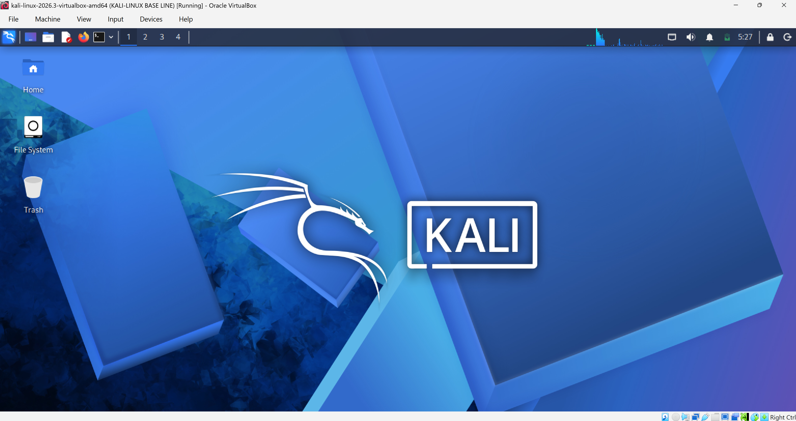
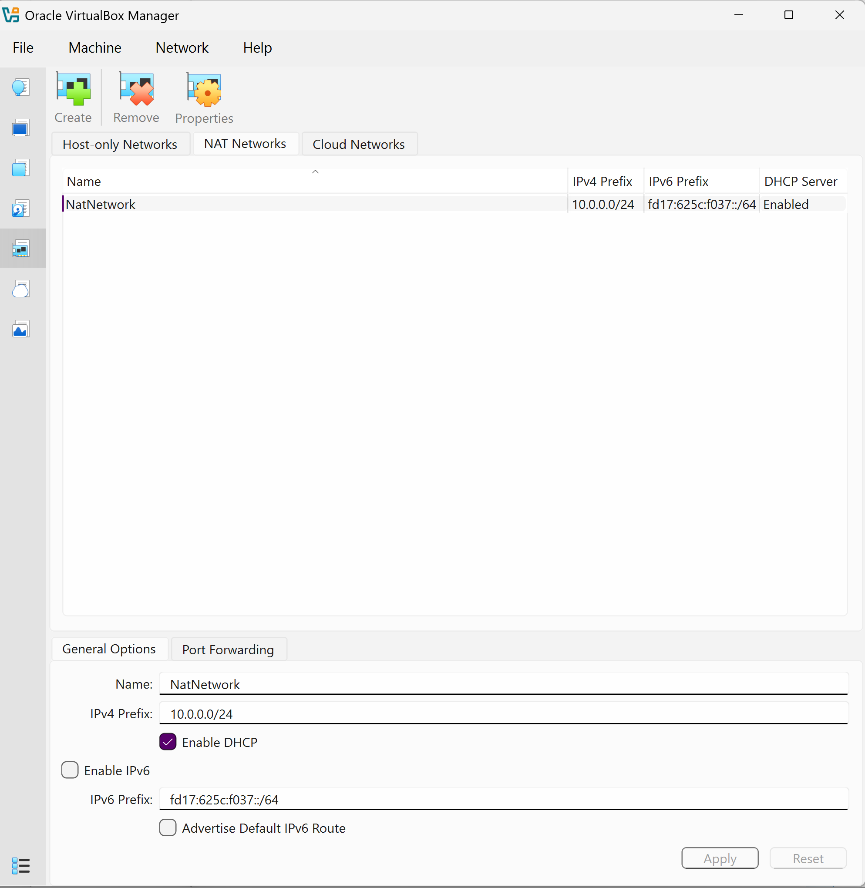
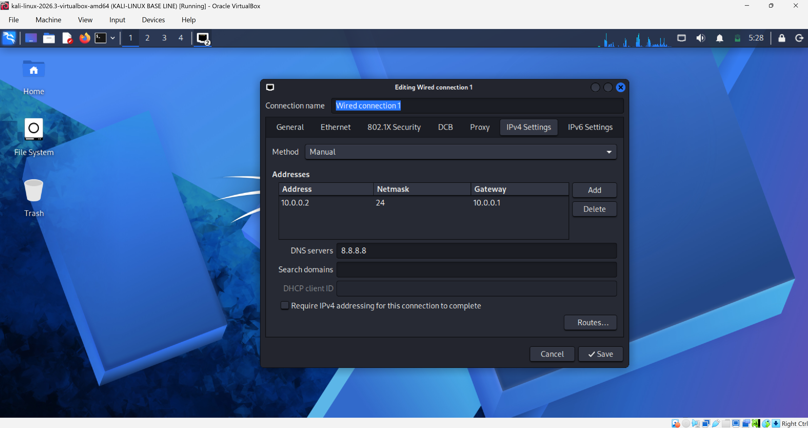
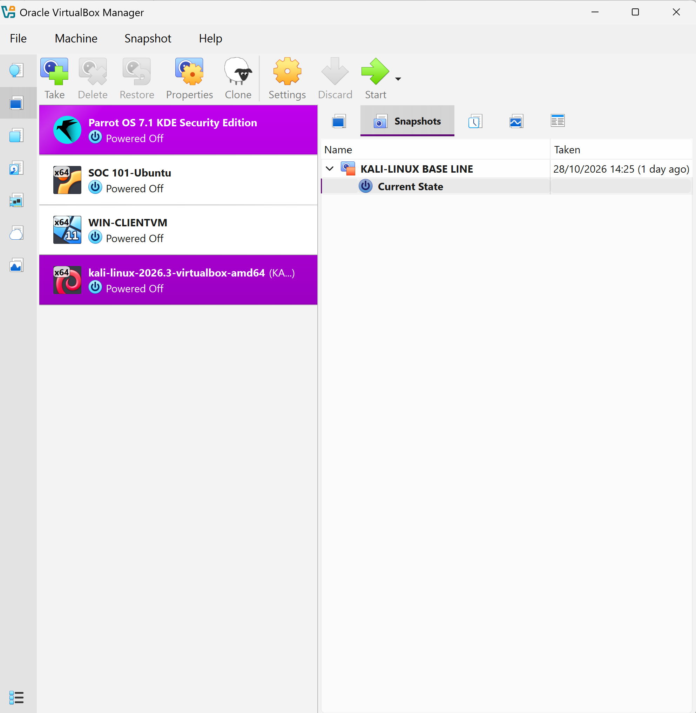

# Cybersecurity Lab (Kali Linux Installation and VirtualBox Network Configuration)

## Project Overview

This project documents the installation, configuration, and preparation of a Kali Linux virtual machine using Oracle VirtualBox as part of my cybersecurity learning and practical lab development.

The objective was to establish a functional Linux-based cybersecurity environment, configure its network settings, troubleshoot connectivity-related issues, verify network configuration, and create a VirtualBox snapshot to preserve the configured environment.

This documentation covers the process from initial setup to the final virtual machine configuration.

## Objectives

- Install and configure Kali Linux in Oracle VirtualBox.
- Configure the virtual machine's network adapter.
- Understand VirtualBox NAT Network connectivity.
- Configure a static IPv4 address using NetworkManager.
- Identify and configure the default gateway and DNS server.
- Troubleshoot network configuration activation issues.
- Create a VirtualBox snapshot as a recovery point.

## Tools and Technologies

| Tool | Purpose |
|---|---|
| Kali Linux | Linux-based cybersecurity environment |
| Oracle VirtualBox | Virtualization platform |
| NetworkManager | Linux network connection management |
| nmcli | Command-line network configuration |
| Linux Terminal | System administration and troubleshooting |

## 1. Kali Linux Installation

Kali Linux was installed as a virtual machine inside Oracle VirtualBox.

The installation provided an isolated environment for cybersecurity practical exercises without requiring a separate physical computer.

**Installation evidence:**



## 2. Virtual Machine Configuration

The virtual machine was configured through VirtualBox to provide the necessary resources for running Kali Linux.

Configuration details:

- Virtualization platform: Oracle VirtualBox
- Guest operating system: Kali Linux
- Virtual machine name: kali-linux-2026.3-virtualbox-amd64
- RAM allocation: 8192 MB
- Processor allocation: 3 cores
- Virtual disk: 80.09GB

## 3. Network Adapter Configuration

The virtual machine's network adapter was configured to provide network connectivity.

The network configuration involved VirtualBox networking settings, including NAT Network and promiscuous mode. 


Promiscuous mode was configured to **Allow All** during the lab setup.

This setting allows the virtual network adapter to receive traffic that would otherwise be filtered by its normal MAC-address restrictions, subject to what the VirtualBox network can actually deliver.

## 4. Static IP Configuration

NetworkManager was used to configure the Kali Linux network interface through `nmcli`.

The following command was used to inspect available network connections:

```bash
nmcli connection show
```

The active network connection was identified as:

```text
Wired connection 1
```

The following static IPv4 configuration was applied:

| Parameter | Value |
|---|---|
| Interface | eth0 |
| Connection profile | Wired connection 1 |
| IPv4 method | Manual |
| IPv4 address | 10.0.0.2/24 |
| Gateway | 10.0.0.1 |
| DNS server | 8.8.8.8 |


The Duplicate Address Detection timeout parameter was modified using:

```bash
sudo nmcli connection modify "Wired connection 1" ipv4.dad-timeout 0
```

The connection was then activated using:

```bash
sudo nmcli connection down "Wired connection 1"

sudo nmcli connection up "Wired connection 1"
```



## 5. Network Configuration Verification

After configuring the network interface, several Linux networking commands were used to verify the configuration such as:

### Checking the IP address

```bash
ip -4 addr show dev eth0
```

The interface displayed:

```text
inet 10.0.0.2/24
```

This confirmed that the configured static IPv4 address was assigned to the `eth0` interface.


### Checking active connections

```bash
nmcli connection show --active
```

This command was used to confirm that the configured connection profile was active.

## 6. Network Troubleshooting

During the network configuration process, an activation error was encountered:

```text
Error: Connection activation failed:
IP configuration could not be reserved
(no available address, timeout, etc.)
```

The issue occurred while attempting to activate the manually configured IPv4 connection.

As part of troubleshooting, the IPv4 Duplicate Address Detection timeout parameter was modified:

```bash
sudo nmcli connection modify "Wired connection 1" ipv4.dad-timeout 0
```

The connection was subsequently activated successfully, and the expected static IP address and routing configuration were verified.

This troubleshooting exercise provided practical exposure to Linux network configuration, NetworkManager, IP addressing, and connection activation.

## 7. Network Connectivity Testing

The following commands was used to test connectivity at different network layers:

```bash
# Test connectivity to the default gateway
ping -c 4 10.0.0.1

# Test external IP connectivity
ping -c 4 8.8.8.8

# Test DNS resolution
ping google.com

```
## 8. VirtualBox Snapshot

After completing the installation and configuration process, a VirtualBox snapshot was created to preserve the virtual machine's current state.

The snapshot provides a recovery point that can be used to return the virtual machine to its saved state if future lab activities introduce configuration problems.



---

**Project Status:** Installation and initial configuration completed.

**Author:** Oluwaniyi Damilare Enoch